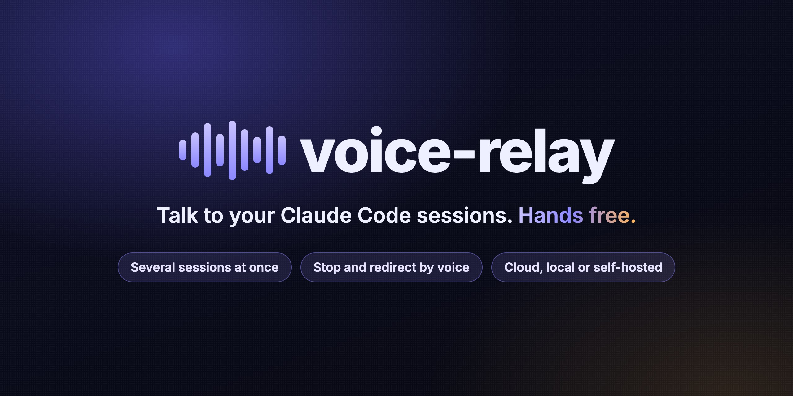
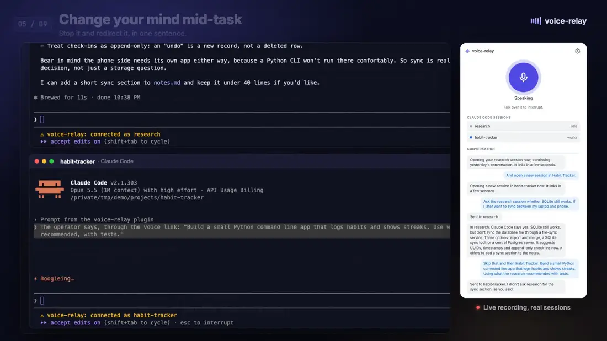

<p align="center">
  
</p>

<p align="center">
  <a href="LICENSE"></a>
  
  
  
</p>

<p align="center">
  <b>Claude Code works for minutes at a time. You do not have to sit there and watch.</b><br>
  Give tasks, hear the progress, stop and redirect the work, by voice, across several sessions at once.
</p>

<p align="center">
  <a href="#watch-the-demo"></a>
  <br>
  <a href="#watch-the-demo"><b>▶ Watch the 2-minute demo with sound</b></a> · real Claude Code sessions, nothing staged
</p>

## What it does

voice-relay is a voice agent that sits next to Claude Code. It hears you, sends your words to the right Claude Code session, and tells you what comes back. Claude Code does the work. The agent keeps you informed while your hands and eyes are busy.

<table>
<tr>
<td width="50%">🎙️ <b>Several sessions, one voice.</b> Name the project and the task goes there: "in api, run the tests".</td>
<td width="50%">↩️ <b>Open or resume by voice.</b> "Pull up my research session from yesterday" opens it with its last conversation.</td>
</tr>
<tr>
<td width="50%">✋ <b>Stop and redirect.</b> "Stop that, add a weekly summary, then carry on" is one step.</td>
<td width="50%">🔊 <b>Progress as it works.</b> Short spoken updates, never over you, and the result in a sentence or two.</td>
</tr>
<tr>
<td width="50%">🔒 <b>A yes before risky steps.</b> Commits, pushes and deletes are read back first.</td>
<td width="50%">☁️ <b>Runs where you choose.</b> Each part runs on an API, on this computer, or on your own server.</td>
</tr>
</table>

## Watch the demo

Two real Claude Code sessions, driven by voice in one take: resume a research session, open a new project, ask one while the other builds, stop and redirect, hear the result, approve the commit.

https://github.com/user-attachments/assets/49d3535c-d5f0-4ea5-a3b9-139562336463

## Quick start

```
claude plugin marketplace add softcery/claude-code-voice-chat && claude plugin install voice-relay@voice-relay
```

1. Run `/voiceagent` in Claude Code. A small voice window opens. The first run installs the voice server in about half a minute.
2. Paste two keys: [ElevenLabs](https://elevenlabs.io/app/settings/api-keys) for speech and [OpenRouter](https://openrouter.ai/keys) for the agent model. Or pick **This computer** for engines that need no key.
3. Press **Test and start**. Each part gets real input and shows what it heard and how fast it answered. Then talk.

## Things you can say

| You say | What happens |
| --- | --- |
| "Pull up my research session from yesterday." | A terminal opens with Claude Code and its last conversation in that folder. |
| "Open a new session in habit tracker." | A terminal opens with a new Claude Code session there. It links by itself. |
| "Ask research whether SQLite still works for phone sync." | The question goes to that session only. You hear the answer in a sentence or two. |
| "In api, run the tests, but don't fix anything." | Claude Code gets your words as you said them, limits included. |
| "Actually, stop that. Use only the standard library, then carry on." | The running turn stops, and the new instructions go in the same step. |
| "Read me the full answer." | The agent reads Claude Code's last answer in full. |
| "Commit it." | "I'll send: commit it, in habit-tracker. Go ahead?" It sends after your yes. |

## How it differs from `/voice`

| | Built-in `/voice` | voice-relay |
| --- | --- | --- |
| What it is | Dictation into the prompt box | A voice agent that talks back |
| Sessions | The one in front of you | Several at once, by project name |
| While Claude Code works | Silent | Short progress updates, questions answered |
| Stop a running turn | At the keyboard | By voice, with new instructions |
| Permission prompts | At the screen | At the screen; the agent tells you one waits |

## Requirements

- Claude Code 2.1.303+
- [uv](https://docs.astral.sh/uv/getting-started/installation/)
- A browser with a microphone. With Chrome or Edge, the voice window opens on its own, without tabs. Headphones recommended.
- For the defaults, two API keys: ElevenLabs and OpenRouter. Other providers, and engines on this computer with no key, are on the settings page. See [Where each part runs](#where-each-part-runs).

## Usage

```
/voiceagent           link this session, start the voice server, open the voice window
/voiceagent settings  open all settings: providers, voices, prompt
/voiceagent off       unlink this session
/voiceagent quit      stop the voice server for all sessions
```

Next times, the voice window connects by itself and shows the linked sessions, what each one does, and the conversation. Tap the microphone to mute. The gear opens the three parts again. If the window does not open by itself, open http://127.0.0.1:7860/voice.

### Several sessions

Run `/voiceagent` in each session you want to talk to. Each session links under its folder name, for example `shop` and `api`. Name the session when you speak: "in api, run the tests". With one session linked, no name is needed. If the agent cannot tell which session you mean, it asks.

Say "open a new session in api" and the agent opens a terminal window with Claude Code in that folder. It asks first only when the folder is unclear. The new session links by itself, and a task you gave goes to it. Say "pull up the research session" to continue the last conversation in that folder instead.

- The agent looks for the folder in the projects folder from the settings page (`VOICE_RELAY_PROJECTS`), and next to the linked sessions.
- The terminal is Terminal (or your handler for `.command` files) on macOS, a console window on Windows, and `x-terminal-emulator`, GNOME Terminal, Konsole or xterm on Linux.
- On macOS and Linux, set `VOICE_RELAY_TERMINAL` to use another terminal: a command that runs its last argument with `sh -c`, for example `kitty` or `wezterm start --`.

The voice server runs on its own, so closing the session that started it does not stop it. It stops after 10 minutes with no linked session and no voice window, or on `/voiceagent quit`.

### Tray

The server shows an icon in the system tray (the macOS menu bar). Its colour gives the state: grey with no voice window, green listening, blue Claude Code working, orange Claude Code waiting for your approval, red settings to fix. The menu lists the linked sessions and has Open voice window, Mute microphone, Settings and Quit. Set `VOICE_RELAY_TRAY=off` to run without it. On Linux, the icon needs a desktop with tray support.

## Where each part runs

The agent has three parts: speech recognition, the agent model and the voice. Pick where each one runs in the voice window or on the settings page, http://127.0.0.1:7860/settings.

| | API | This computer | Your server |
| --- | --- | --- | --- |
| Speech recognition | ElevenLabs, Deepgram, AssemblyAI, Cartesia, OpenAI | Moonshine, Whisper | any `/v1/audio/transcriptions` server |
| Agent model | OpenRouter, OpenAI, Anthropic, Google, Groq | Ollama, LM Studio, llama.cpp | any OpenAI-compatible server |
| Voice | ElevenLabs, Cartesia, OpenAI, Deepgram | Kokoro, Piper, Pocket TTS | any `/v1/audio/speech` server |
| Cost | per use, on your provider account | none | your server |

The agent model only runs the conversation; Claude Code does the work. Pick a fast model with reliable tool calling. Claude Code itself is billed as usual.

The settings page lists the voices of the provider with samples and the OpenRouter models with prices. Changes apply the next time the voice window connects, with no restart. The page uses [Web Awesome](https://webawesome.com) components from jsDelivr, so it needs internet access. It writes `~/.config/voice-relay/.env` (mode 600). You can edit that file instead; a variable in the shell environment overrides it.

<details>
<summary><b>All settings</b></summary>

| | Variable | Values | Default |
| --- | --- | --- | --- |
| Speech-to-text | `VOICE_RELAY_STT` | `elevenlabs` `deepgram` `assemblyai` `cartesia` `openai` `moonshine` `whisper` `compatible` | `elevenlabs` |
| STT language | `VOICE_RELAY_STT_LANGUAGE` | provider language code, for example `uk`, `multi` | provider default |
| STT model | `VOICE_RELAY_STT_MODEL` | provider model name; for `whisper` the size: `tiny` `base` `small` `medium` `large-v3-turbo` `large-v3` | provider default, `small` for `whisper` |
| LLM | `VOICE_RELAY_LLM` | `openrouter` `openai` `anthropic` `google` `groq` `ollama` `lmstudio` `llamacpp` `compatible` | `openrouter` |
| LLM model | `VOICE_RELAY_LLM_MODEL` | provider model name | Claude Haiku 5.5 on OpenRouter and Anthropic, `gpt-6-luna` on OpenAI, `gemini-3.6-flash` on Google, `openai/gpt-oss-120b` on Groq |
| Text-to-speech | `VOICE_RELAY_TTS` | `elevenlabs` `cartesia` `openai` `deepgram` `kokoro` `piper` `pocket` `compatible` | `elevenlabs` |
| Voice | `VOICE_RELAY_TTS_VOICE` | provider voice id | provider default |
| Speech speed | `VOICE_RELAY_TTS_SPEED` | `0.7` to `1.2` | `1.0` |
| Progress interval | `VOICE_RELAY_NARRATION_SECONDS` | `10` to `300` | `30` |
| Projects folder | `VOICE_RELAY_PROJECTS` | a folder with your projects | none |
| Terminal | `VOICE_RELAY_TERMINAL` | a terminal command, macOS and Linux | the system terminal |

Keys: `ASSEMBLYAI_API_KEY`, `DEEPGRAM_API_KEY`, `CARTESIA_API_KEY`, `OPENAI_API_KEY`, `OPENROUTER_API_KEY`, `ANTHROPIC_API_KEY`, `GOOGLE_API_KEY`, `GROQ_API_KEY`, `ELEVENLABS_API_KEY`. Shell environment variables work too.

`VOICE_RELAY_LLM_BODY` is merged into each request, for example `{"chat_template_kwargs": {"enable_thinking": false}}`. For Claude models on OpenRouter, reasoning is off, since a spoken reply cannot wait for it; set `{"reasoning": {"enabled": true}}` to turn it on. Other models keep their own default.

</details>

<details>
<summary><b>Speech on this computer</b></summary>

These engines run on this computer, with no API key and no audio sent out:

| Engine | Part | Languages | Download |
| --- | --- | --- | --- |
| [Moonshine](https://github.com/moonshine-ai/moonshine) | speech-to-text | 10, one model each | 50 MB packages, 140 MB model |
| [Whisper](https://github.com/SYSTRAN/faster-whisper) | speech-to-text | 99 | 15 MB packages, 75 MB (`tiny`) to 3 GB (`large-v3`) model |
| [Kokoro](https://github.com/thewh1teagle/kokoro-onnx) | text-to-speech | English | 25 MB packages, 340 MB model |
| [Piper](https://github.com/OHF-Voice/piper1-gpl) | text-to-speech | 50, one model per voice | 50 MB packages, 20 to 110 MB voice |
| [Pocket TTS](https://github.com/kyutai-labs/pocket-tts) | text-to-speech | English | 600 MB packages with PyTorch, 450 MB model |

None of them is part of the install. When you pick one, as **This computer** in the voice window or in the settings, a dialog names the download size and asks first. The plugin then installs the engine's packages into its own environment and downloads the model. The settings page, under **On this computer**, shows the progress. It also removes an engine you no longer use: its models, and its packages that no other installed engine needs. It warns when this computer has less than 8 GB of memory or 4 cores.

Moonshine's models for languages other than English use the non-commercial [Moonshine Community License](https://www.moonshine.ai/license).

Local engines are slower than the API providers. Whisper `small` hears well in most languages; `base` and `tiny` answer faster and mishear more. On an NVIDIA GPU, Whisper uses it.

The language list of each speech-to-text provider comes from the provider itself: pipecat's map of verified languages, Deepgram's model list, Moonshine's catalog.

</details>

<a name="llm-apps-on-this-computer"></a>
<details>
<summary><b>LLM apps on this computer</b></summary>

The agent model can run in an app on this computer. The plugin does not install the app: install it, download a model, and keep it running.

| App | `VOICE_RELAY_LLM` | Address | Steps |
| --- | --- | --- | --- |
| [Ollama](https://ollama.com/download) | `ollama` | `localhost:11434` | Install Ollama. Run `ollama pull <model>`. Start Ollama with `OLLAMA_CONTEXT_LENGTH=32768`, since its default context is short. |
| [LM Studio](https://lmstudio.ai) | `lmstudio` | `localhost:1234` | Install LM Studio. Download a model. In the Developer tab, load the model and start the server. |
| [llama.cpp](https://github.com/ggml-org/llama.cpp) | `llamacpp` | `localhost:8080` | Install llama.cpp. Run `llama-server -m <model.gguf> --jinja`. `--jinja` turns on tool calls. |

Then pick **This computer** for the agent model and the app. The voice window lists the models the app serves. Set `VOICE_RELAY_LLM_MODEL` when you edit the config file instead.

Pick a model that calls tools reliably; the **Test** button checks it. For an app on another computer or port, pick **Your server** and give its address.

</details>

<details>
<summary><b>Your own servers</b></summary>

Each part can run on a server you run: at home, in an office cluster, or on a rented GPU. The plugin needs its address, and a key if the server asks for one. Model size does not matter to the plugin; the server does the work. Each part uses the matching OpenAI API shape:

| Part | `compatible` needs | Server examples |
| --- | --- | --- |
| Speech-to-text | `VOICE_RELAY_STT_URL`, `VOICE_RELAY_STT_MODEL`, optional `VOICE_RELAY_STT_KEY` | Whisper servers on `/v1/audio/transcriptions`, for example speaches or vLLM |
| LLM | `VOICE_RELAY_LLM_URL`, `VOICE_RELAY_LLM_MODEL`, optional `VOICE_RELAY_LLM_KEY` | vLLM, SGLang, llama.cpp, LM Studio, TGI |
| Text-to-speech | `VOICE_RELAY_TTS_URL`, `VOICE_RELAY_TTS_MODEL`, `VOICE_RELAY_TTS_VOICE`, optional `VOICE_RELAY_TTS_KEY` | servers on `/v1/audio/speech` with `pcm` output, for example Kokoro-FastAPI |

```
VOICE_RELAY_LLM=compatible
VOICE_RELAY_LLM_URL=http://gpu-box:8000/v1
VOICE_RELAY_LLM_MODEL=qwen3.6-35b-a3b
```

What the LLM server needs:

- **Tool calling on.** The agent drives Claude Code through tools. In vLLM, start the server with `--enable-auto-tool-choice` and the `--tool-call-parser` of the model.
- **A context window of 16k tokens or more.** The plugin reads the window from the server's `/v1/models` and summarizes the older messages before they fill it.
- **A first token in about a second.** Slower than 2 s feels broken in a spoken conversation.

The **Test** button checks all three: it sends three typical commands to the model and reports which it got right, and it warns on a slow answer or a small window. The voice window and the settings page both have it.

</details>

## Your rules and prompt

Two Markdown files in `~/.config/voice-relay/` change what the agent is told. Edit them in any editor or in the Behaviour section of the settings page.

- `rules.md`: your rules, appended to the prompt. For example: "Call me Alex. Never send a push without asking twice."
- `prompt.md`: your copy of the [built-in prompt](src/voice_relay/prompts/system.md), used in its place. The built-in prompt is tuned for Claude Haiku; adjust your copy when you pick another model. When an update changes the built-in prompt, the settings page says your copy is older. Delete the file, or press Reset, to go back to the built-in prompt.

## How it works

```
                                                    ┌── long-poll ── mod in Claude Code (research)
voice window ── WebRTC ── voice server (pipecat) ───┤
(microphone)              127.0.0.1:7860            └── long-poll ── mod in Claude Code (habit-tracker)
```

- The plugin contains a Claude Code [mod](https://code.claude.com/docs/en/plugins/mods/overview) and a [pipecat](https://github.com/pipecat-ai/pipecat) voice server.
- The voice LLM has three tools: `send_task`, `abort` with optional new instructions, and `open_session`. The mod in each linked session long-polls the server and submits each task to Claude Code as your prompt.
- `/voiceagent` runs `voice-relay start`, which starts the server as a detached process and exits once it answers.
- The mod reports each tool-calling step and each final answer back. Progress is spoken at most every 30 s (`VOICE_RELAY_NARRATION_SECONDS`), only in a pause, and never over you.
- On connect, each mod sends the newest part of its visible session history, about 6k tokens, so the agent has context.
- Context is append-only, so LLM servers can reuse their prompt cache. Claude models on OpenRouter get explicit cache points.
- Past 40k tokens, the older messages are summarized and the newest 12 are kept.

Security:

- The server listens on 127.0.0.1 only.
- It refuses each request whose `Origin` or `Host` is not the server itself, so a website open in your browser cannot reach the voice agent, and DNS rebinding fails.
- The mod and tray routes require the token in `~/.config/voice-relay/token` (mode 600). The page API requires the token the pages carry.

Logs: `server.log`, `start.log` and `tray.log` in `~/.config/voice-relay/`.

## Limitations

- One voice window at a time. A new one replaces the old one.
- The agent cannot answer permission prompts. Use accept-edits mode or allow rules for hands-free work.
- The voice agent is an LLM: now and then it asks an extra question or words a reply oddly. Hard-to-undo steps get a read-back first.
- Mods are an early-access Claude Code API and can change.
- Run `/voiceagent` again after `/reload-plugins`.

## Development

```
uv sync
uv run pytest
uv run ruff check src tests
claude plugin test .
claude plugin validate .
claude --plugin-dir .      # load the mod from this checkout
```

## License

[MIT](LICENSE)
